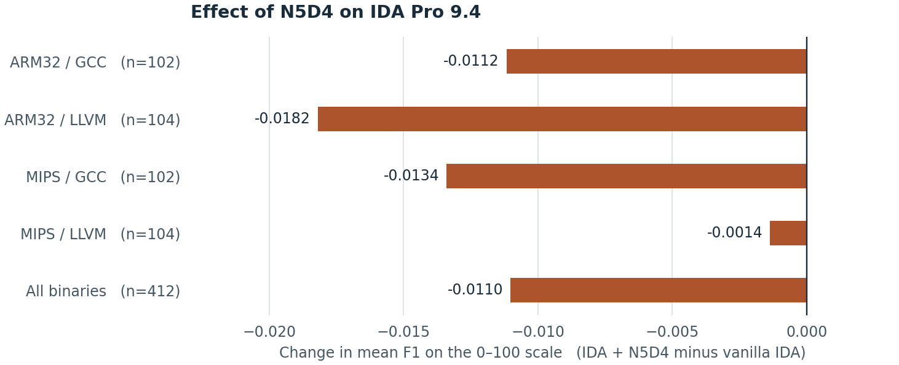

# N5D4 for IDA Pro

*Neurosymbolic Disassembly* 논문 발표를 듣고 두 가지가 궁금했습니다. IDA Pro에서도 이 방법으로 자동 분석이 놓친 코드를 더 찾을 수 있을까? Ghidra를 최신 버전으로 올리면 논문에서 보고한 결과는 어떻게 달라질까? 직접 확인하려고 N5D4를 IDA Pro용으로 포팅하고, 저자들이 공개한 Coreutils 바이너리로 두 도구를 비교했습니다.

IDA가 놓친 코드 블록을 찾고 IDB의 디스어셈블 결과를 보완하는 IDAPython 스크립트입니다. 현재 열린 바이너리에서 학습 데이터를 만들고 LTN 분류기를 학습합니다. 처음 실행하면 점수가 높은 후보부터 주소와 함께 확인할 수 있습니다. IDAPython에는 Python 3.10 이상이 필요합니다.

**Attribution.** This independent IDA Pro port is based on Zhaoqi Xiao’s N5D4 for Ghidra and the CCS 2026 paper *Neurosymbolic Disassembly*. The original BSD 3-Clause copyright notice is preserved. [Upstream N5D4](https://github.com/gdjs2/N5D4/tree/4550b15f7332398e1a9a68622f4efdee9a80fccb) · [Paper](https://doi.org/10.1145/3830454.3832592) · [NOTICE](NOTICE) · [LICENSE](LICENSE)

<!-- benchmark:start -->

## 평가 결과

GNU Coreutils의 stripped ELF **412개**에서 Vanilla IDA의 평균 F1은 **0.99889**, N5D4를 적용한 IDA는 **0.99878**였습니다. 적용 후 F1이 오른 입력은 1개, 같은 입력은 246개, 낮아진 입력은 165개입니다.

### 전체 Coreutils에서 IDA 적용 전후

| 빌드 | 바이너리 수 | Vanilla IDA F1 | IDA + N5D4 F1 | 변화 (100점 환산) |
|---|---:|---:|---:|---:|
| ARM32 / GCC | 102 | 1.00000 | 0.99989 | -0.0112 |
| ARM32 / LLVM | 104 | 0.99999 | 0.99981 | -0.0182 |
| MIPS / GCC | 102 | 0.99756 | 0.99743 | -0.0134 |
| MIPS / LLVM | 104 | 0.99801 | 0.99800 | -0.0014 |
| All binaries | 412 | 0.99889 | 0.99878 | -0.0110 |

전체에서 새로 찾은 정답 코드는 **16바이트**였고, 데이터를 코드로 잘못 분류한 바이트도 **3,848바이트** 늘었습니다. 각 바이너리의 코드 바이트 F1을 같은 가중치로 평균했습니다. 실행 가능 영역의 기존 데이터도 후보에 포함했으며 모델 점수 기준은 0.50입니다.



### 같은 base64 네 빌드에서 Ghidra와 IDA 비교

같은 파일 네 개를 각 버전에서 직접 열어 측정했습니다. 기본 분석은 코드 바이트, NSDA 적용 후는 논문 아티팩트의 4바이트 간격 채점으로 계산했습니다. 이 네 파일에서 IDA판은 두 채점 방식의 F1이 같았습니다.

| 디스어셈블러 | 기본 평균 F1 | NSDA 적용 후 평균 F1 |
|---|---:|---:|
| IDA Pro 9.4 | 0.99884 | 0.99858 |
| Ghidra 11.3.2 | 0.88142 | 0.99051 |
| Ghidra 12.0.4 | 0.88699 | 0.99091 |
| Ghidra 12.2 | 0.88067 | 0.99002 |

Ghidra 12.2에서 저자 구현은 평균 F1을 100점 환산 **10.94점** 높였습니다. 같은 네 파일에서 가장 높은 평균 F1은 IDA Pro 9.4의 기본 분석으로 얻은 0.99884였습니다.


Ghidra 12.2와 IDA 9.4의 버전별 직접 비교 범위는 위 네 빌드입니다. 논문 표 4·9와의 대조, 정밀도·재현율, 오류 바이트 수 및 재현 명령은 [전체 평가 보고서](evaluation/REPORT.md)에 있습니다. [저자 평가 코드](https://github.com/gdjs2/NSDA) · [Coreutils 데이터셋](https://github.com/gdjs2/NSDA-coreutils-dataset)

<!-- benchmark:end -->

## 실행

1. IDA Pro에서 바이너리를 열고 초기 자동 분석을 마칩니다.
2. **File → Script file…** 에서 이 폴더의 **N5D4.py** 를 선택합니다.
3. **Preview candidates** 로 실행합니다. 결과표의 행을 더블클릭하면 해당 주소로 이동합니다.
4. 결과를 반영하려면 다시 실행해 **Apply to database** 를 선택합니다. 포트가 명령어를 만들고 블록 시작에 점수를 주석으로 남긴 뒤 IDA 자동 분석을 기다립니다. 다음 패스에서는 변경된 IDB에서 특징과 제어 흐름을 다시 계산합니다. 완료한 각 패스는 IDA의 **Edit → Undo** 로 되돌릴 수 있습니다.

처음 설치할 때 프로젝트 폴더에서 다음 명령을 한 번 실행합니다. IDA 프로세스는 Python 표준 라이브러리와 IDAPython을 사용하고, 별도의 Python 프로세스가 PyTorch 및 LTNtorch를 로드합니다.

```powershell
py -m venv .venv
.\.venv\Scripts\python.exe -m pip install -r requirements.txt
```

다른 학습 환경을 쓰려면 IDA를 시작하기 전에 `N5D4_PYTHON`을 해당 인터프리터의 절대 경로로 지정합니다. CUDA를 지원하는 PyTorch에서 CUDA를 사용할 수 있으면 GPU를 선택하며, 그 외 환경에서는 CPU를 사용합니다. macOS/Linux의 기본 학습 인터프리터 경로는 `.venv/bin/python`입니다. 실제 검증 환경은 Windows 및 IDA Pro 9.4입니다.

플러그인 메뉴에 고정하려면 IDA 사용자 plugins 폴더에 `N5D4` 하위 폴더를 만들고 `ida-plugin.json`, `N5D4.py`, `n5d4_train.py`, `LICENSE`를 그 안에 복사합니다. `N5D4_PYTHON`을 이 프로젝트의 가상 환경 Python으로 지정한 뒤 IDA를 다시 열고 **Edit → Plugins → N5D4 disassembly refinement** 를 실행합니다.

## 분석 옵션

| 옵션 | 기본값 | 동작 |
|---|---:|---|
| Minimum code score | 50% | 점수가 임계값 이상이고 블록 전체를 디코딩할 수 있는 후보를 선택합니다. 점수는 분류기 출력입니다. |
| Training epochs per pass | 500 | 패스당 학습 상한입니다. 손실이 0.01 미만이면 조기 종료합니다. |
| Maximum passes in Apply mode | 5 | 새 코드가 생긴 동안 반복합니다. 미리보기는 한 패스를 실행합니다. |
| Include defined data | 끔 | 켜면 기존 데이터도 후보가 됩니다. IDA 데이터 항목의 중간을 자르는 블록은 건너뜁니다. |
| Include segments without execute permission | 끔 | 실행 권한 정보가 없는 펌웨어 등에서 후보 범위를 넓힙니다. 권한 비트가 모두 0인 CODE 세그먼트는 기본 범위에 포함됩니다. |

적용 중 취소하거나 명령어 생성에 실패하면 진행 중인 패스를 IDA의 Undo 지점으로 되돌립니다. 적용하려면 IDA의 Undo 기록을 켜야 합니다. 학습 워커에는 블록 특징, 규칙에 해당하는 블록 번호, 간선 번호를 전달합니다. 모델과 중간 파일은 실행이 끝나면 정리합니다.

## 논문과 공개 구현의 대응

| 구성 | IDA판에서의 처리 |
|---|---|
| 블록 및 의사 디스어셈블 | IDB의 초기화된 8비트 주소 공간을 Code·Data·Unknown으로 구분합니다. `decode_insn`으로 미리 읽고 호출·분기·종료 명령에서 나눕니다. 세그먼트와 미초기화 구간 경계를 지킵니다. |
| 표 1의 아홉 특징 | 문자열 참조, 상수, 제어 이전, 호출, 명령어, 산술 연산, 0 바이트, 16개 명령어 내 def-use, 출력 가능한 ASCII 수를 블록 바이트 길이로 나눕니다. |
| 프로세서 의미 | 산술·비교는 정규화한 명령어 이름으로 근사합니다. def-use는 IDA 프로세서가 보고한 레지스터 읽기·쓰기와 피연산자 플래그를 이용합니다. 따라서 Ghidra P-code의 임시 변수, 메모리 접근 및 연산 개수와 차이가 있습니다. ARM/Thumb 모드는 IDA가 해당 주소에 설정한 모드를 따릅니다. |
| 학습 | MLP 9→32→64→1, ReLU, sigmoid, Adam 0.001, LTNtorch의 안정화된 p-mean error(p=4)를 사용합니다. 모델은 다음 패스에서 이어 학습하며 패스마다 Adam 상태를 초기화합니다. |
| 규칙 | 기존 코드·데이터, 비교 후 조건 분기, 비교 없는 조건 분기, 높은 0 바이트 비율, 연속 ASCII, 디코딩 실패를 사용합니다. 공개 스크립트에 맞춰 fallthrough에는 함의를, 기존 코드에서 확인한 호출·점프 참조에는 양방향 동치를 적용합니다. |

논문 본문의 학습은 900에폭이고 이 포트의 기본값은 공개 스크립트와 평가 설정의 500에폭입니다. 미정의 블록은 코드·데이터 정답 그룹에서 제외합니다. 마지막 바이트를 포함하며 50% 기준은 블록의 실제 길이로 계산합니다. 이 구현은 공개된 전체 바이너리 방식의 포트입니다. 논문 5.5절의 Chromium용 Segmented NSDA는 별도 변형입니다.

원본 스크립트의 BSD 3-Clause 고지는 [LICENSE](LICENSE)에 있습니다. [N5D4 원본 코드](https://github.com/gdjs2/N5D4/blob/4550b15f7332398e1a9a68622f4efdee9a80fccb/ghidra_scripts/N5D4Disassembly.py) · [Neurosymbolic Disassembly](https://doi.org/10.1145/3830454.3832592)

## 검증

설치된 IDA Pro의 idalib를 사용할 수 있는 Python으로 아래 명령을 실행합니다. 통합 테스트는 임시 바이너리와 IDB를 생성해 미리보기, 명령어 복원, 기존 주석 보존, Undo, 부분 실패 복구를 확인합니다.

```powershell
python -X utf8 -u tests/ida_smoke.py
```

논문 부속 데이터셋의 평가 방법과 측정값은 [Coreutils 평가 보고서](evaluation/REPORT.md)에 있습니다.
