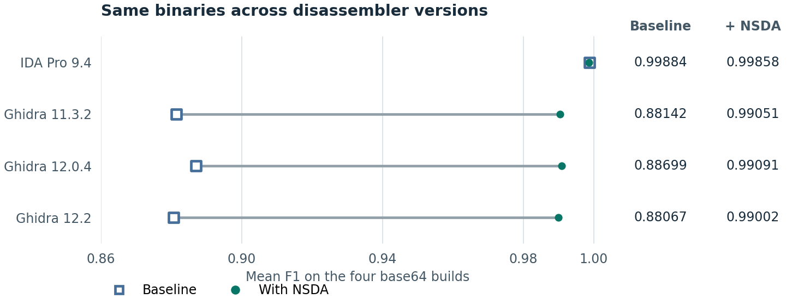

# N5D4 for IDA Pro

After hearing the presentation on *Neurosymbolic Disassembly*, I had two questions. Could the same method recover code that IDA Pro’s automatic analysis misses? And would a newer Ghidra release change the results reported in the paper? I ported N5D4 to IDA Pro and tested both disassemblers on the authors’ GNU Coreutils binaries to find out.

The IDAPython plugin trains a logic tensor network (LTN) on the open binary and ranks blocks that may contain missed code. You can inspect each candidate in IDA before applying changes to the database. The plugin requires IDAPython with Python 3.10 or later.

**Attribution.** This independent IDA Pro port is based on Zhaoqi Xiao’s N5D4 for Ghidra and the CCS 2026 paper *Neurosymbolic Disassembly*. The original BSD 3-Clause copyright notice is preserved. [Upstream N5D4](https://github.com/gdjs2/N5D4/tree/4550b15f7332398e1a9a68622f4efdee9a80fccb) · [Paper](https://doi.org/10.1145/3830454.3832592) · [NOTICE](NOTICE) · [LICENSE](LICENSE)

<!-- benchmark:start -->

## Benchmark results

Across **412 stripped GNU Coreutils ELF binaries**, vanilla IDA Pro 9.4 scored **0.99889** mean code-byte F1. With N5D4, it scored **0.99878**. F1 rose on 1 of the binaries, stayed the same on 246, and fell on 165.

### IDA before and after N5D4 on the full corpus

| Build | Binaries | Vanilla IDA F1 | IDA + N5D4 F1 | Change in F1 (0–100 scale) |
|---|---:|---:|---:|---:|
| ARM32 / GCC | 102 | 1.00000 | 0.99989 | -0.0112 |
| ARM32 / LLVM | 104 | 0.99999 | 0.99981 | -0.0182 |
| MIPS / GCC | 102 | 0.99756 | 0.99743 | -0.0134 |
| MIPS / LLVM | 104 | 0.99801 | 0.99800 | -0.0014 |
| All binaries | 412 | 0.99889 | 0.99878 | -0.0110 |

N5D4 recovered **16 additional bytes of labeled code** and classified **3,848 additional bytes outside the ground-truth code set** as code. Each binary has equal weight in the mean. The benchmark used a score threshold of 0.50 and included defined data in executable segments.


### IDA and Ghidra on the same four base64 builds

Each version analyzed the same four files. Baseline F1 counts code bytes. The NSDA column uses the authors’ scorer, which samples blocks at four-byte intervals. Both scoring methods gave the same F1 for the IDA port on these four inputs.

| Disassembler | Baseline mean F1 | Mean F1 with NSDA |
|---|---:|---:|
| IDA Pro 9.4 | 0.99884 | 0.99858 |
| Ghidra 11.3.2 | 0.88142 | 0.99051 |
| Ghidra 12.0.4 | 0.88699 | 0.99091 |
| Ghidra 12.2 | 0.88067 | 0.99002 |

On Ghidra 12.2, the authors’ implementation raised mean F1 by **10.94 points** on the 0–100 scale. The highest mean F1 on these four files was 0.99884 (IDA Pro 9.4, baseline).



The direct comparison of IDA 9.4 and Ghidra 12.2 covers the four demo builds. The full report compares the corpus results with Tables 4 and 9 of the paper and gives precision, recall, byte counts, and reproduction commands. [Evaluation report](evaluation/REPORT.md) · [Authors’ evaluation code](https://github.com/gdjs2/NSDA) · [Coreutils dataset](https://github.com/gdjs2/NSDA-coreutils-dataset)

<!-- benchmark:end -->

## Installation and use

From the project directory, create a Python environment for the training worker. IDA runs the plugin with IDAPython and the Python standard library. A separate process loads PyTorch and LTNtorch.

```powershell
py -m venv .venv
.\.venv\Scripts\python.exe -m pip install -r requirements.txt
```

On macOS and Linux, the worker looks for `.venv/bin/python`. To use another environment, set `N5D4_PYTHON` to the absolute path of its Python interpreter before starting IDA. The worker uses CUDA when PyTorch detects a compatible GPU and otherwise uses the CPU. This port was tested on Windows with IDA Pro 9.4.

1. Open a binary in IDA Pro and wait for automatic analysis to finish.
2. Choose **File → Script file…** and select `N5D4.py`.
3. Choose **Preview candidates**. Double-click a row to inspect the address in IDA.
4. To apply the results, run the script again and choose **Apply to database**. The plugin creates instructions, adds the model score as a comment at each block start, and waits for IDA to finish reanalysis. Each subsequent pass recomputes features and control flow from the updated database. Use **Edit → Undo** to reverse one completed pass at a time.

To add a permanent menu entry, create an `N5D4` subdirectory in your IDA user plugins directory. Copy `ida-plugin.json`, `N5D4.py`, `n5d4_train.py`, and `LICENSE` into it. Set `N5D4_PYTHON` to the interpreter in the project’s virtual environment, restart IDA, and choose **Edit → Plugins → N5D4 disassembly refinement**.

## Analysis options

| Option | Default | Behavior |
|---|---:|---|
| Minimum code score | 50% | Selects fully decodable blocks whose classifier score meets the threshold. |
| Training epochs per pass | 500 | Sets the training limit for each pass. Training stops early if the loss drops below 0.01. |
| Maximum passes in Apply mode | 5 | Continues while a pass discovers new code. Preview runs one pass. |
| Include defined data | Off | Includes existing data items as candidates. The plugin skips blocks that would split a defined data item. |
| Include segments without execute permission | Off | Extends the search to segments such as firmware regions that lack execute permissions. The default already includes CODE segments whose permission bits are all zero. |

Enable IDA’s Undo history before applying changes. If you cancel a pass or IDA cannot create an instruction, the plugin rolls back that pass. The training worker receives block features and the indices of blocks and edges used by the rules. It discards the model and temporary files when the run ends.

## How the port implements the paper

| Component | IDA implementation |
|---|---|
| Blocks and speculative disassembly | Groups initialized regions of the IDB’s 8-bit address space into code, data, and unknown blocks. Decodes candidates with `decode_insn`, splitting at calls, branches, and terminating instructions. Blocks stop at segment boundaries and uninitialized regions. |
| Nine features from Table 1 | Counts string references, constants, control transfers, calls, instructions, arithmetic operations, zero bytes, definition–use pairs within 16 instructions, and printable ASCII bytes. Normalizes each count by the block length in bytes. |
| Instruction semantics | Uses normalized mnemonics to identify arithmetic and comparisons. Register reads and writes from IDA’s processor module and operand flags approximate definition–use relationships. Ghidra’s P-code can represent additional temporaries, memory accesses, and operations, so feature counts can differ. ARM/Thumb decoding follows the mode IDA assigns to each address. |
| Training | Uses a 9→32→64→1 multilayer perceptron, ReLU, a sigmoid output, Adam with a learning rate of 0.001, and LTNtorch’s stabilized p-mean error (p = 4). Each pass reuses the model weights and resets the optimizer. |
| Rules | Uses known code and data, conditional branches with or without a preceding comparison, a high proportion of zero bytes, consecutive ASCII bytes, and decoding failures. As in the public script, fallthrough edges use implication, and call and jump references from known code use equivalence. |

The paper describes 900 training epochs. The public script and evaluation configuration use 500, which is the port’s default. The port excludes undefined blocks from labeled code and data groups, includes the last byte of each block, and uses the full block length to test whether zero bytes or a single run of printable ASCII occupy at least half the block. It implements the public whole-binary method. Section 5.5 describes a separate segmented variant for Chromium. [Upstream implementation](https://github.com/gdjs2/N5D4/blob/4550b15f7332398e1a9a68622f4efdee9a80fccb/ghidra_scripts/N5D4Disassembly.py) · [Paper](https://doi.org/10.1145/3830454.3832592) · [BSD 3-Clause license](LICENSE)

## Verification

Run the integration test with a Python interpreter configured to use your IDA Pro installation’s `idalib`. It creates a temporary binary and IDB to verify candidate preview, instruction recovery, comment preservation, Undo, and rollback after a partial failure.

```powershell
python -X utf8 -u tests/ida_smoke.py
```

For benchmark inputs, scoring details, raw measurements, and reproduction commands, see the [Coreutils evaluation report](evaluation/REPORT.md).
